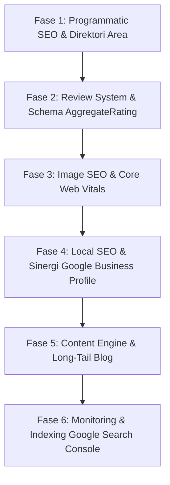

# Rencana Aksi SEO: Strategi Menembus Peringkat 5 Besar Google (Top 5)

Dokumen ini adalah **panduan eksekusi teknis dan strategis** untuk membawa platform ini dan profil MUA di dalamnya menduduki **Top 5 pencarian Google**. Dokumen ini dirancang agar dapat dieksekusi secara bertahap oleh AI atau developer.

---

## Ringkasan Eksekutif & Arsitektur Strategi

Untuk menduduki peringkat 5 besar, kita harus membagi strategi menjadi 2 target pencarian:
1. **Pencarian Platform (Head Keywords):**  
   Target: *"Platform MUA Indonesia"*, *"Aplikasi booking makeup artist"*, *"Software portofolio MUA"*.  
   Strategi: Dominasi landing page utama, otoritas brand, dan konten edukasi.
2. **Pencarian Jasa Lokal (Local Intent & Long-tail Keywords):**  
   Target: *"MUA wisuda Jakarta"*, *"MUA wedding Depok"*, *"Jasa rias pengantin Bandung"*.  
   Strategi: **Programmatic SEO (halaman agregator kota & layanan)**, **Google Business Profile (GBP)**, dan **Review/Rating Schema**.

---

## Roadmap Eksekusi (6 Fase)



---

## FASE 1: Programmatic SEO — Halaman Direktori Area & Kategori Layanan

### Masalah Saat Ini
Saat ini calon klien mencari *"MUA Wisuda Jakarta"*, tetapi web hanya memiliki URL per username `/[username]`. Google kesulitan mencocokkan pencarian agregat ini jika tidak ada halaman khusus kota/kategori.

### Rencana Tindakan Teknis

#### 1. Buat Route Direktori Area: `app/(main)/area/[area]/page.tsx`
* **URL Target:** `/area/jakarta`, `/area/depok`, `/area/surabaya`, dll.
* **Fungsi:** Mengambil seluruh MUA aktif melalui `listPublicMuas()` dari `lib/api/public.ts`, lalu memfilter MUA yang memiliki `serviceArea` sesuai parameter kota.
* **On-Page SEO Elements:**
  - `<h1>`: *"Daftar Makeup Artist (MUA) Profesional di {Nama Kota}"*
  - `<p>`: Deskripsi lokal dengan kata kunci variasi (wisuda, wedding, photoshoot, pesta).
  - List card MUA (Brand Name, Foto Profil, Rentang Harga, Badge Layanan, Link ke `/{username}`).
  - Dynamic Metadata:
    ```typescript
    export async function generateMetadata({ params }): Promise<Metadata> {
      const { city } = await params;
      const formattedCity = decodeURIComponent(city).replace(/-/g, " ");
      return {
        title: `10+ MUA Terbaik di ${formattedCity} | Harga & Portofolio`,
        description: `Cari dan booking Makeup Artist (MUA) terbaik di ${formattedCity}. Lihat portofolio rias pengantin, wisuda, pesta, dan ulasan harga transparan.`,
        alternates: { canonical: `${siteConfig.url}/area/${area}` }
      };
    }
    ```
  - Schema JSON-LD: `CollectionPage` + `ItemList` berisi entitas `BeautySalon` / `LocalBusiness`.

#### 2. Buat Route Kategori Service: `app/(main)/service/[slug]/page.tsx`
* **URL Target:** `/service/wisuda`, `/service/wedding`, `/service/engagement`.
* **Fungsi:** Menampilkan daftar MUA yang memiliki layanan atau portofolio dengan kategori terkait.
* Lengkapi folder `app/(main)/service/[slug]` yang saat ini masih kosong.

#### 3. Perbarui `app/sitemap.ts`
Daftarkan seluruh rute kota dan kategori layanan ke sitemap secara otomatis:
```typescript
// Tambahkan daftar kota unik dari seluruh serviceArea MUA
const allServiceAreas = Array.from(
  new Set(profiles.flatMap((p) => p.serviceArea || []))
);
const cityUrls = allServiceAreas.map((city) => ({
  url: `${siteConfig.url}/area/${encodeURIComponent(area.toLowerCase().replace(/\s+/g, "-"))}`,
  lastModified: new Date(),
  changeFrequency: "weekly" as const,
  priority: 0.9,
}));
```

---

## FASE 2: Sistem Ulasan & Rich Snippet (Rating Bintang di Google)

### Masalah Saat Ini
File `lib/testimonials.ts` saat ini masih kosong (`[]`), dan belum ada schema `AggregateRating`. Hasil pencarian Google yang menampilkan bintang kuning memiliki **CTR (Click-Through Rate) 35% lebih tinggi**.

### Rencana Tindakan Teknis

#### 1. Tambahkan Model Ulasan / Testimoni di Backend & Frontend
* Field: `clientName`, `rating` (1–5), `reviewText`, `serviceName`, `eventDate`, `createdAt`.
* Berikan akses MUA untuk meminta testimoni dari klien yang status booking-nya sudah `COMPLETED`.

#### 2. Implementasikan Schema `AggregateRating` di `app/(main)/[username]/page.tsx`
Tambahkan ke dalam structured data:
```json
{
  "@type": "LocalBusiness",
  "name": "Nama MUA",
  "aggregateRating": {
    "@type": "AggregateRating",
    "ratingValue": "4.9",
    "reviewCount": "18",
    "bestRating": "5",
    "worstRating": "1"
  },
  "review": [
    {
      "@type": "Review",
      "author": { "@type": "Person", "name": "Siti Rahma" },
      "reviewRating": { "@type": "Rating", "ratingValue": "5" },
      "reviewBody": "Hasil makeup wisuda sangat tahan lama dan natural."
    }
  ]
}
```

---

## FASE 3: Image SEO & Optimasi Core Web Vitals (LCP)

### Masalah Saat Ini
Pencarian industri kecantikan/MUA sangat bergantung pada **Google Image Search**. Foto yang tidak terindeks dengan baik akan kehilangan potensi 40% traffic organik.

### Rencana Tindakan Teknis

#### 1. Standarisasi Alt-Text Portofolio
Pastikan alt-text portofolio tidak kosong atau generik. Terapkan generator format alt-text otomatis di dashboard atau fallback frontend:
* **Format Bagus:** `Makeup [Kategori] oleh [Nama MUA] di [Area Layanan] - [Judul Portofolio]`
* **Contoh:** *"Makeup Wisuda Natural oleh Aldena Makeup di Depok - Riasan Flawless Hijab"*

#### 2. Optimasi Next.js Image Component
* Di `components/HomeClient.tsx` dan komponen portofolio:
  - Berikan `priority={true}` hanya untuk gambar hero/banner utama (Largest Contentful Paint).
  - Gunakan `loading="lazy"` untuk seluruh grid portofolio di bawah lipatan (*below the fold*).
  - Atur `sizes` atribut secara akurat:
    ```tsx
    sizes="(max-width: 640px) 100vw, (max-width: 1024px) 50vw, 33vw"
    ```
* Pastikan CDN media (Supabase/S3/Laravel Storage) mendukung kompresi format WebP / AVIF.

---

## FASE 4: Local SEO & Sinergi Google Business Profile (GBP)

Google memprioritaskan **Google Maps 3-Pack** untuk pencarian lokal. Strategi ini menghubungkan website platform Anda dengan profil Google resmi tiap MUA.

### Rencana Tindakan

#### 1. Konsistensi NAP (Name, Address, Phone)
* Pada halaman profil MUA, pastikan Nama Bisnis, Alamat/Kota, dan Nomor WhatsApp cocok 100% dengan data yang didaftarkan di Google Maps.
* Pastikan field `hasPhysicalAddress` memicu schema `PostalAddress` dengan benar.

#### 2. Checklist Integrasi di Dashboard MUA
Tambahkan kartu edukasi / widget di dashboard MUA:
* *"Tingkatkan Klien dari Google"*
  - [ ] Pasang URL profil MUA Anda (`https://domain.com/username`) pada kolom Website di **Google Business Profile**.
  - [ ] Cantumkan link profil di bio Instagram & TikTok.
  - [ ] Lengkapi jam operasional dan area layanan.
* *Efek Teknis:* Setiap MUA yang memasang link profil mereka di Google Maps akan memberikan **backlink resmi bernilai lokal tinggi** ke domain platform Anda.

---

## FASE 5: Content Engine — Menjaring Long-Tail Keywords

Untuk mengalahkan kompetitor besar, targetkan kata kunci dengan niat informasi (*informational intent*) yang sering diketik calon klien sebelum memesan.

### Rencana Tindakan

#### 1. Buat Modul Artikel / Blog Sederhana: `app/(main)/blog/[slug]/page.tsx`
Topik-topik dengan persaingan rendah tetapi konversi tinggi:
1. *"Biaya & Daftar Harga Jasa MUA Wisuda Terbaru"*
2. *"Perbedaan Makeup Flawless, Bold, dan Soft Glam untuk Lamaran"*
3. *"Tips Mempersiapkan Kulit Wajah Sebelum Hari H Pernikahan"*
4. *"Cara Memilih MUA Pengantin yang Tepat & Anti Luntur"*

Setiap artikel harus menyertakan CTA (Call-to-Action) langsung ke halaman pencarian MUA atau pendaftaran MUA.

---

## FASE 6: Monitoring, Tracking & Indexing

1. **Google Search Console (GSC):**
   - Verifikasi domain melalui DNS record atau meta tag di `app/layout.tsx` (`process.env.NEXT_PUBLIC_GOOGLE_VERIFICATION`).
   - Submit URL sitemap utama: `https://domain.com/sitemap.xml`.
   - Lakukan *URL Inspection* untuk halaman-halaman baru agar bot Google segera melakukan crawling.
2. **PageSpeed Insights:**
   - Pertahankan skor Performance > 90, SEO = 100, Accessibility > 90 pada perangkat mobile.
3. **Bing Webmaster Tools & IndexNow:**
   - Pasang integrasi IndexNow untuk memberitahu search engine secara instan saat ada MUA baru mendaftar atau portofolio baru diunggah.

---

## Checklist Eksekusi Bertahap untuk AI Agent

Salin perintah berikut untuk menugaskan pengerjaan fase-fase di atas kepada AI:

- [ ] **Prompt 1 (Fase 1):** *"Buka file `SEO_ACTION_PLAN_TOP_5.md`. Buat route `app/(main)/area/[area]/page.tsx` untuk menampilkan daftar MUA berdasarkan kota, lengkap dengan dynamic metadata dan schema CollectionPage/ItemList."*
- [ ] **Prompt 2 (Fase 1 Lanjutan):** *"Buka file `SEO_ACTION_PLAN_TOP_5.md`. Buat route `app/(main)/service/[slug]/page.tsx` untuk kategori layanan, dan perbarui `app/sitemap.ts` agar menyertakan semua kota dan kategori tersebut."*
- [ ] **Prompt 3 (Fase 2):** *"Buka file `SEO_ACTION_PLAN_TOP_5.md`. Implementasikan schema `AggregateRating` dan `Review` pada halaman profil MUA di `app/(main)/[username]/page.tsx`."*
- [ ] **Prompt 4 (Fase 3):** *"Buka file `SEO_ACTION_PLAN_TOP_5.md`. Optimalkan atribut alt-text dan sizing Next Image pada portofolio di `components/HomeClient.tsx`."*
- [ ] **Prompt 5 (Fase 4):** *"Buka file `SEO_ACTION_PLAN_TOP_5.md`. Tambahkan widget panduan optimasi Google Business Profile pada dashboard MUA di `app/(admin)/dashboard/page.tsx`."*
